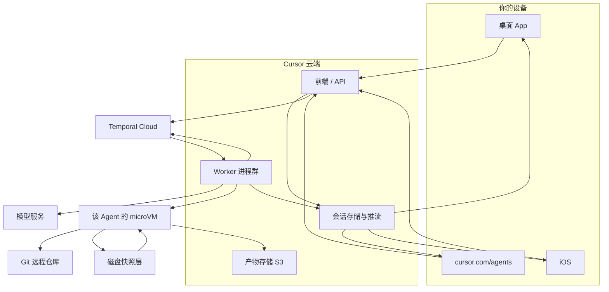
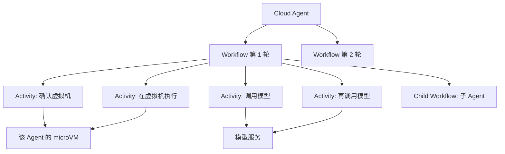
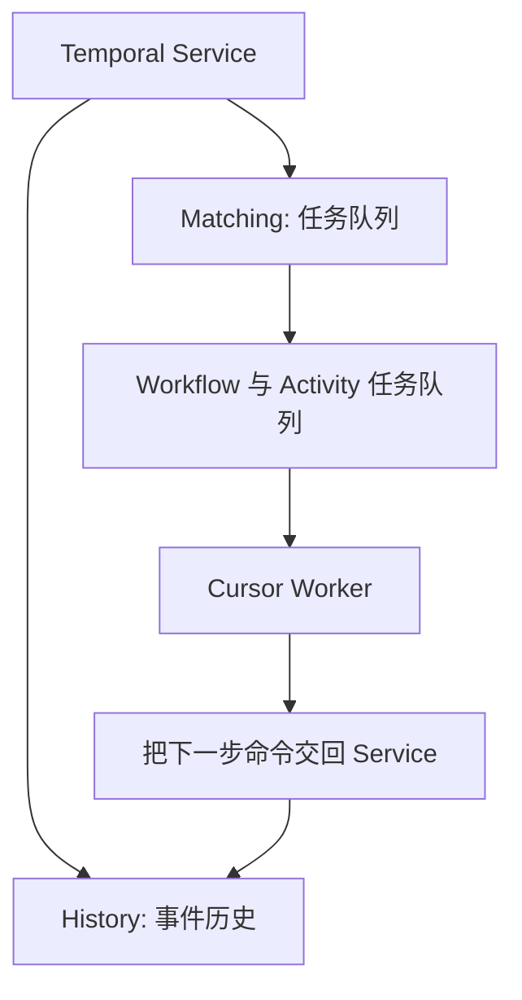
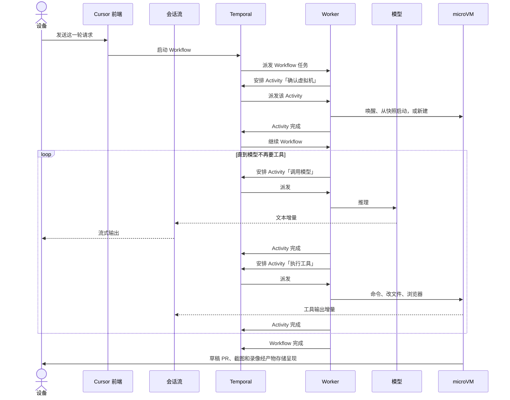
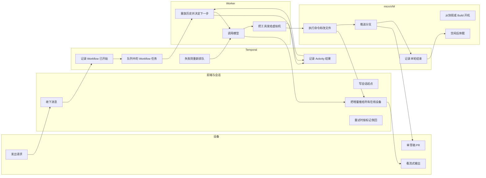
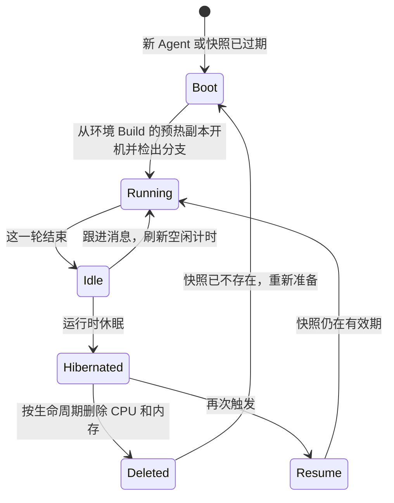
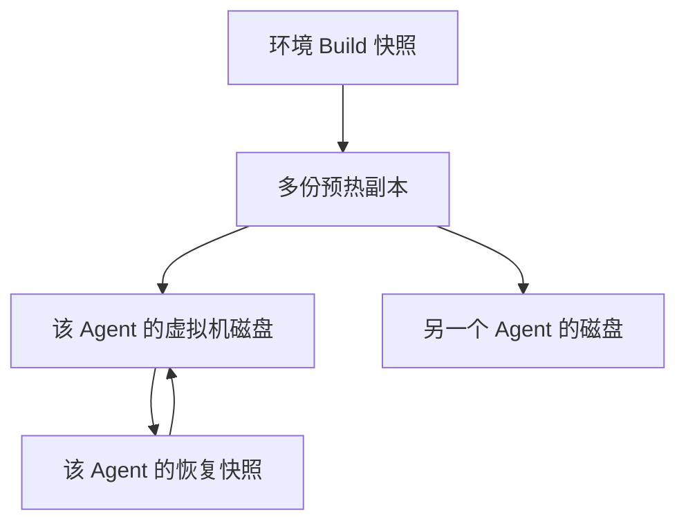
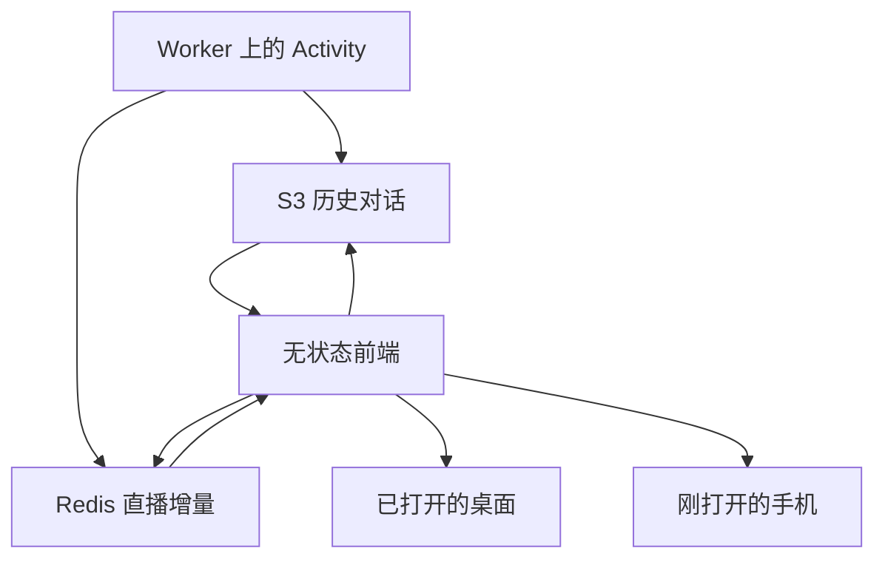
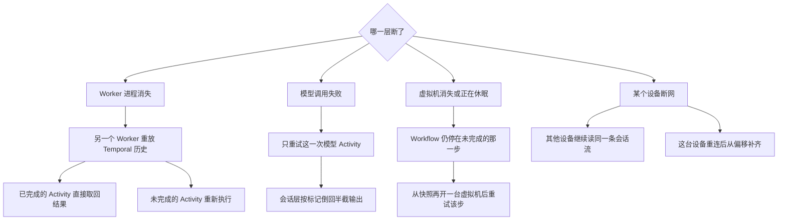
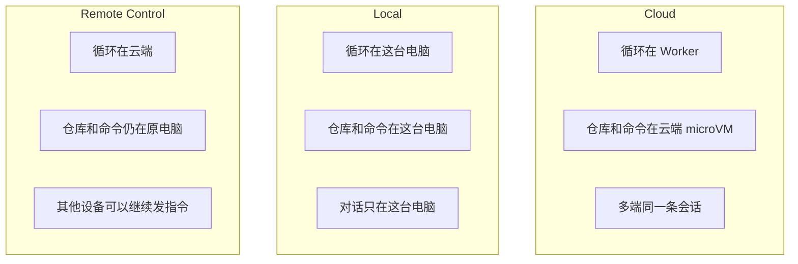

# Cursor 云端架构说明

整理日期：2026-10-12

这份说明根据 Cursor 公开文档、官方博客，以及一场 Cursor 工程师演讲的第三方整理写成。它描述 Cloud Agent 的运行方式，不代表 Cursor 未公开的内部实现。

证据分三档：

- **官方**：Cursor 文档和博客。包括安全说明、Build、Cloud Agents API，以及 [What we've learned building cloud agents](https://cursor.com/blog/cloud-agent-lessons)。
- **演讲整理**：Cursor 工程师在 Temporal 上的分享，经由第三方记录。Temporal Cloud、Worker 的部署位置、S3 与 Redis 的分工属于这一档。博客没有写到这一层。
- **未公开**：快照的底层介质、Redis 的数据类型和过期时间、桌面端订阅会话流的具体协议。这些不画成已确认的组件。

## 1. 总览

一次 Cloud 任务分成三条线。编排线决定下一步，环境线在虚拟机里改代码、跑命令，会话线把增量推到各个设备。三条线通过 Activity 的开始和结束对齐。正在生成的 token 和命令输出不写入 Temporal 的事件历史。

桌面、网页、手机都把消息交给 Cursor 后端，再从同一条会话流里读进度。Worker 向 Temporal 领任务。需要推理时调用模型，需要仓库和终端时进入这台 Agent 专属的 Firecracker microVM。虚拟机从 Git 远程克隆，或基于快照恢复，不读取你笔记本上的工作区。

官方材料中的来源：

- [Security overview](https://cursor.com/docs/cloud-agent/security)
- [Secrets and Network](https://cursor.com/docs/cloud-agent/security-network)
- [Cloud Agent Builds](https://cursor.com/docs/cloud-agent/builds)
- [Cloud Agents API](https://cursor.com/docs/cloud-agent/api/endpoints)
- [Cursor for iOS](https://cursor.com/docs/cloud-agent/mobile)

演讲整理中的来源：Worker 部署在 Cursor 自己的 Amazon 机群上，Temporal 使用托管的 Temporal Cloud。见 [ZenML 对这场演讲的记录](https://www.zenml.io/llmops-database/building-and-operating-agentic-ai-coding-products-at-scale-with-temporal)。

## 2. 概念各在哪一层

| 概念 | 是什么 | 跑在哪 | 寿命 |
| --- | --- | --- | --- |
| Cloud Agent | 你看到的一次任务：对话、工作区、分支 | 跨后端、Temporal、虚拟机 | 可跨很多天。空闲后机器收掉，对话仍在 |
| Agent loop | 想一步、做一步、看结果、再想 | Worker 上的 harness | 一轮里来回多次 |
| Workflow | 这一轮的可重放编排 | Worker 执行，历史在 Temporal | 一轮任务结束就退出 |
| Activity | 一次模型调用，或一次交给环境的动作 | Worker 执行；环境动作落到虚拟机 | 这一步结束。失败则整步重试 |
| Worker | 领队列、跑 Workflow / Activity 的进程 | Cursor 的 Amazon 机群 | 与某个 Agent 无关，做完去领下一单 |
| microVM | 仓库、依赖、终端、浏览器 | 独立 AWS 账号里的 Firecracker | 空闲后休眠再删除 |
| 磁盘快照 | 虚拟机磁盘的时间点副本 | 活动虚拟机之外的快照层 | 连续 90 天不用则删除 |

Workflow 和 agent loop 不是同一个东西。Agent loop 是行为：模型决定下一步，环境执行，结果再交回模型。Workflow 是 Temporal 里记下这个循环走到哪一步的那次编排。一个 Cloud Agent 可以先后对应多条 Workflow。一条 Workflow 通常只覆盖一轮用户请求。

一条 Workflow 不是预先画死的节点图。开头固定检查虚拟机，中间按模型的决定循环，结束时把结果交到出口。循环转几圈，写 Workflow 时并不知道。

子 Agent 是运行中再启动的 child workflow，有自己的事件历史。演讲整理里的常见做法是复用父流程的循环，并跳过创建虚拟机，因为默认共用父 Agent 的环境，只换一套新的对话上下文。博客同时允许子任务跑在另一种 pod 上，例如只读虚拟机或预热虚拟机。

插话分成两种：

- 这一轮还在跑，新消息作为 Signal 进入当前 Workflow，插到下一步的空隙里。
- 这一轮已经结束，再发消息会再启动一条 Workflow，重新检查虚拟机，接上保存好的对话和工作区。

演讲整理把这种跟进称为 Temporal 的 signal-with-start。

## 3. Temporal 里的四个词

Temporal 是持久执行平台。Cursor 的演讲整理写明用的是 Temporal Cloud，业务代码仍由 Cursor 自己的 Worker 执行。官方说明见 [How Temporal works](https://docs.temporal.io/encyclopedia/architecture/how-temporal-works)。

| 词 | 含义 |
| --- | --- |
| Temporal | 记住事件历史，并把下一步放进任务队列。Worker 主动来拉，Service 不把任务推到某一台固定机器 |
| Workflow | 可重放的编排代码，以及它的一次运行。决定顺序，不直接访问网络 |
| Activity | Workflow 发出的一个可重试步骤。调用模型、在虚拟机里执行，都在这里 |
| Worker | 执行 Workflow 和 Activity 代码的进程。进度在 Temporal 里，不在某个 Worker 的内存里 |

Runner 是迁到 Temporal 之前的角色。当时一台 Amazon ECS 上的 runner 会被固定分给一个 Agent，由它把模型和虚拟机的来回做到结束。进程一断，循环就断。它不是 Temporal 的名词。

Worker 还有一个同名但不同层的东西：自托管机器上用 `agent worker start` 拉起的执行进程。那个进程待在你的电脑上跑命令。这里的 Worker 是向 Temporal 领编排任务的进程。

建议继续阅读的 Temporal 文档：

- [Temporal architecture](https://docs.temporal.io/encyclopedia/architecture/temporal-architecture)
- [Tasks](https://docs.temporal.io/tasks)
- [Task queues](https://docs.temporal.io/task-queue)
- [Workflow execution](https://docs.temporal.io/workflow-execution)
- [Temporal SDKs](https://docs.temporal.io/encyclopedia/temporal-sdks)

Temporal 内部还有一个 Worker Service，负责 Temporal 自己的维护任务。那个服务和 Cursor 的 Worker 不是同一个东西。

## 4. 一轮请求怎么走

Temporal 记下的是每一步的安排、完成或失败。恢复时，另一个 Worker 从头重放 Workflow 代码。历史上已经成功的 Activity 直接取回当时的结果，模型不会被再叫一次。代码走到还没有结果的那一步，该 Activity 才真正执行。

因此 Temporal 同时做两件事：保存事件历史，以及把下一步派给 Worker。它保存的是步骤边界和结果，不是 Agent 进程的整块内存。

## 5. 泳道

模型调用和「决定下一步」在 Worker。虚拟机只执行已经决定好的环境动作，例如文件、终端、测试、浏览器。不碰工作区的工具留在后端的 Activity 里。Harness 不在虚拟机里。

## 6. 虚拟机和磁盘

安全文档里的一次运行经过这些阶段：启动、准备隔离虚拟机并克隆授权仓库、在虚拟机里执行并流式返回、把对话和产物写入 Cursor 管理的存储、推送分支并打开草稿 pull request、空闲后休眠再删除运行时资源。

空闲之后留下来的，是虚拟机外面的一份磁盘快照。再次触发时，Cursor 用这份快照启动一台虚拟机，从而免掉重新克隆仓库。文档没有说把同一块磁盘重新挂回原来那台机器。

| 数据 | 在哪 | 空闲之后 |
| --- | --- | --- |
| 正在跑的工作区 | 这台虚拟机的磁盘。上面有检出的仓库、构建产物和命令现场 | 空闲后回收。再发消息会刷新计时 |
| 虚拟机快照 | 活动虚拟机之外的快照和缓存层。是磁盘的某个时间点副本，含已克隆的代码 | 连续 90 天没有启动或恢复就删除。每次启动或恢复，再顺延 90 天 |
| 对话 | Cursor 后端，按 Agent 单独加密 | 默认保留，可以删除。企业版可封顶 90 天 |
| 密钥 | 加密的凭证存储 | 直到你删除 |

隔离单位是每一个 Agent，不是每一个用户共用一块盘。每个 Agent 有自己的虚拟机边界，一台看不到另一台的代码、环境和状态。静态加密是 AES-256，会话数据按 Agent 各自的密钥加密。这些虚拟机放在独立的 AWS 账号里。

物理介质当然在 Cursor 的存储集群上。文档没有把它写成所有 Agent 同时挂载同一块大盘，再用目录互相隔开。每台 microVM 只看见自己的那块盘。

Build 是装好仓库和依赖的启动模板，许多 Agent 可以拿它当起点。某个 Agent 后来改过的文件只在它自己的磁盘和恢复快照里。快照不能手动立刻删除。删除 Agent 只删除对话和产物。

仓库磁盘和截图录像不是同一个地方。截图、录像、日志上传到 `cloud-agent-artifacts.s3.us-east-1.amazonaws.com`。快照底下是块存储、镜像文件，还是再放到对象存储里，公开说明没有写。

90 天留着的是加密的磁盘副本，不是一台一直开着的虚拟机。开着的 CPU 和内存在空闲后回收。一个用户有多个 Agent，就会有多份快照。

## 7. 多端如何看到同一条流

新设备先读 S3 上已经落稳的历史。若这一轮仍在进行，再从历史结束的位置接着读 Redis。两边读的是后端同一条日志，不是两台设备互相对时。

演讲整理还写到：每个 Activity 往直播流里写标记，标明后面这段内容是哪一个 Activity 产生的。标记的位置若比当前读到的位置还靠前，说明这个 Activity 失败后重试了，前端把流倒回到那个偏移，再用新内容往下读。这些写入按内容寻址，重试时可以取回已经生成的模型输出。

公开 API 把这一轮对外编码成 SSE，并用 `Last-Event-ID` 续传。响应头 `X-Cursor-Stream-Retention-Seconds` 表示这一次 run 的直播积压还能留多久，具体秒数没有公布。窗口结束后可以返回 `410 stream_expired`，客户端改去读这一轮的最终状态。这条 API 不重放更早的 run。

桌面和 App 内部是否也用 SSE 帧去存 Redis，没有公开。Redis 的数据类型、key 和过期时间也没有公开。整理稿里的 “Redis streams” 和偏移量，说明它是一条能按位置接着读的日志，但不能据此写成已经公开的 Redis Stream schema。

## 8. 故障时各自续在哪

命令跑到一半时虚拟机被收掉，这条命令不会在新机器的内存里接着跑。环境恢复之后，这一整个 Activity 再试。编排进度因为在 Temporal 里，所以不用从第一句话重来。

早期架构是 work-stealing：某个 runner 领走一个 Agent，在自己的进程里做到完。博客写那时大约只有 1 个 9 的可靠性。迁到 Temporal 之后超过 2 个 9。博客给出的规模是每天超过 5000 万个 action，覆盖超过 700 万个 workflow。

## 9. Cloud、Local、Remote Control

选 Cloud 的那一次运行在云端。桌面、网页和手机会看到同一条会话。

选 Local 的执行和对话都留在那一台电脑上。Cursor 论坛里工作人员说明，Local 记录在本机工作区数据中，换一台机器不会跟着走。两台电脑上各开一个 Local Agent，是两次独立执行。

`/remote-control` 把模型这一环放到云端，文件、终端、测试和 git 仍在原来那台电脑上。电脑需要开着。这不是 Cloud 模式，也不会把工作区搬进云端虚拟机。

Move to Cloud 带走的是对话和上下文。未提交、未推送的本地改动不会进虚拟机。

## 10. 文档没有写死的部分

下面这些在公开材料里没有写死，本文没有把它们画成具体产品：

- 快照底下是块存储还是对象存储。
- 一份 Agent 快照相对 Build 是全量拷贝还是增量。
- Redis 的数据结构、key 和保留时间。
- 桌面、网页、iOS 订阅会话流时用的具体协议。公开 API 的 SSE 只说明对外接口。
- 托管虚拟机从机器到 Cursor 后端的那一跳，是如何把终端输出送出虚拟机的。自托管机器写明了只通过已有的出站 HTTPS 发送。
